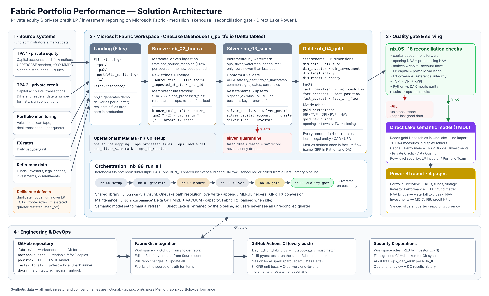
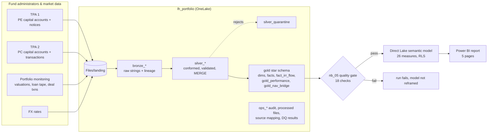

# Fabric Portfolio Performance — private markets reporting on Microsoft Fabric

An end-to-end Microsoft Fabric project for **private equity and private credit** portfolio reporting:
fund-administrator files land in OneLake, flow through a bronze → silver → gold medallion lakehouse, pass an
18-check reconciliation gate, and feed a **Direct Lake Power BI** model with investor (LP) and investment
performance: **IRR, TVPI, DPI, RVPI, NAV, unfunded commitment and a NAV bridge**, in fund currency,
legal-entity currency, CAD or USD.

It is a working portfolio project with synthetic data. All fund, investor and company names are fictional.





## What's in it

| Area | Highlights |
|---|---|
| **Ingestion** | Metadata-driven bronze (`ops_source_mapping`): two administrators with different headers, date formats, sign conventions and number formats; SHA-256 file tracking, so reruns are no-ops and re-sent files are picked up |
| **Silver** | ANSI-safe parsing, rule-based quarantine with reasons, restatement handling (`_v2` beats `_v1`), MERGE upserts on business keys |
| **Gold star schema** | `fact_cashflow`, `fact_snapshot`, `fact_commitment`, `fact_position`, `fact_accrual` + 6 dimensions; every amount carried in **local, legal-entity, CAD and USD** |
| **Metrics defined once** | `fact_irr_flow` fixes sign convention, terminal value and FX rule; Python (`gold_performance`) and DAX both compute from it with the same XIRR convention, and a parity check proves they agree |
| **NAV bridge** | Opening NAV → contributions → distributions → fees → income → realised → unrealised → **FX translation** → closing NAV, per currency |
| **Quality gate** | 18 checks, including capital-account roll-forward, opening = prior closing, notices = capital account, LP capital = portfolio valuation, FX coverage, referential integrity, TVPI = DPI + RVPI and metric parity. A failure blocks the semantic-model refresh |
| **Power BI** | PBIP project: TMDL Direct Lake model (26 measures, 26 relationships, LP row-level security) + a 5-page report (Overview, Investor Performance, NAV Bridge, Investments, Data Quality) |
| **Engineering** | Fabric Git-integration item layout, local Spark runner that executes the *same* notebook files, 15 pytest tests including a 3-delivery end-to-end scenario, GitHub Actions CI |

## Repository layout

```
fabric/                          ← connect this folder to the Fabric workspace (Git integration)
  lh_portfolio.Lakehouse/
  nb_common.Notebook/            shared config, table/file helpers, XIRR, FX
  nb_00_setup.Notebook/          ops tables + source-mapping contract
  nb_01_generate_source_files.Notebook/   synthetic TPA 1 / TPA 2 / valuation / FX deliveries
  nb_02_bronze.Notebook/         … nb_03_silver, nb_04_gold, nb_05_quality_gate
  nb_06_maintenance.Notebook/    OPTIMIZE + VACUUM
  nb_99_run_all.Notebook/        DAG orchestration + semantic-model reframe
notebooks_src/                   notebook source (# %% cells) → tools/build_fabric_items.py → fabric/
powerbi/                         PortfolioPerformance.pbip (SemanticModel TMDL + Report)
tools/                           build_fabric_items.py · build_powerbi.py · configure_powerbi.py
local/run_local.py               runs the Fabric notebooks on local Spark (parquet instead of Delta)
tests/                           XIRR unit tests + end-to-end incremental/restatement scenario
docs/                            ARCHITECTURE · DATA_CONTRACT · METRICS · RUNBOOK · POWERBI_BUILD_GUIDE · INTERVIEW_TALK_TRACK
```

## Quick start (local, no Fabric needed)

```bash
pip install -r requirements-dev.txt          # needs Java 17 (Spark 3.5) or 17/21 (Spark 4)
python local/run_local.py --fresh            # setup → generate → bronze → silver → gold → gate (~2 min)
python -m pytest -v                          # 15 tests, ~4 min
```

## Deploy to Fabric

1. Push this repo to GitHub or Azure DevOps. In the workspace, open **Workspace settings → Git integration**, connect it, and set the **Git folder** to `/fabric`. Choose **Update all**: the lakehouse and 9 notebooks appear.
2. Open `nb_99_run_all` and click **Run all**. It generates the demo files, loads every layer and runs the gate.
3. Run `nb_00_setup` and copy the two SQL-endpoint values from its last cell. Then, locally:
   `python tools/configure_powerbi.py --server <host> --endpoint-id <guid> --into-fabric`, then commit and **Update all** again.
   You can also open `powerbi_configured/PortfolioPerformance.pbip` in Power BI Desktop and publish it.
4. In the semantic model settings, turn **off** "Keep your Direct Lake data up to date". `nb_99_run_all` reframes the model only after the gate passes.
5. Schedule `nb_99_run_all`, plus `nb_06_maintenance` weekly.

The full steps, how to switch to real administrator files, and how to handle a failed gate are in [docs/RUNBOOK.md](docs/RUNBOOK.md).

## What has and hasn't been verified

* **Verified here:** every notebook runs end to end on local Spark 4.0 and Spark 3.5 (Fabric Runtime 1.3's engine), using parquet in place of Delta. All 18 checks pass, and all 15 tests pass:
  * XIRR matches Excel's documented example;
  * restatement, idempotent rerun and quarantine behave as described;
  * the NAV bridge closes in every currency;
  * Python IRR is recomputed from `fact_irr_flow`.
* **Not verified here (no Fabric tenant or Power BI Desktop available when this was built):** Delta `MERGE`/`OPTIMIZE` in Fabric, `notebookutils` calls, and opening the PBIP in Desktop. The TMDL and `report.json` follow the published PBIP formats. If Desktop rejects the report layout, [docs/POWERBI_BUILD_GUIDE.md](docs/POWERBI_BUILD_GUIDE.md) rebuilds the same model and pages in about 30 minutes from `docs/METRICS.md`.
