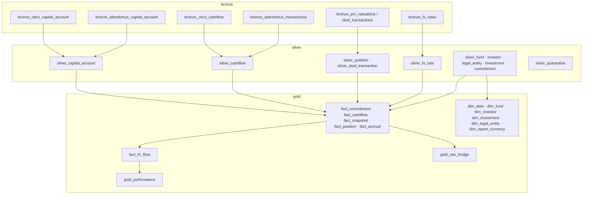

# Architecture

## Context

A private-markets manager runs private equity (PE) and private credit (PC) funds. It needs:

* **investor (LP) reporting:** each LP's commitment, paid-in, distributions, NAV and net performance;
* **investment reporting:** each deal's cost, fair value and gross performance, plus loan-level accruals for credit;
* **performance attribution:** a NAV bridge per quarter in the currency each audience uses.

Data arrives as quarterly files from two fund administrators (Citco for PE, Alter Domus for PC), a
portfolio-monitoring system and an FX source. The previous process depended on manual spreadsheets,
and every audience computed IRR slightly differently.

## Fabric items

| Item | Purpose |
|---|---|
| `lh_portfolio` (Lakehouse) | One lakehouse for all layers. Tables are separated by prefix: `bronze_`, `silver_`, `dim_`, `fact_`, `gold_`, `ops_`, `sec_`. The landing zone is `Files/landing/<source>/`; reference CSVs are in `Files/reference/` |
| `nb_common` | Shared code, loaded with `%run`. It resolves the lakehouse's OneLake path with `notebookutils.lakehouse`, so no notebook depends on a default lakehouse being attached |
| `nb_00`…`nb_06`, `nb_99` | Setup, demo generator, bronze, silver, gold, quality gate, maintenance, orchestrator (`runMultiple` DAG) |
| `PortfolioPerformance` (Semantic model) | Direct Lake on the SQL analytics endpoint; 16 tables, 26 measures, RLS |
| `PortfolioPerformance` (Report) | Overview, Investor Performance, NAV Bridge, Investments, Data Quality |

## Data flow and layer rules

| Layer | Rule |
|---|---|
| **Bronze** | Append-only. Every column is kept as a string, with the columns exactly as delivered. Lineage columns are added: `_source_file`, `_file_version`, `_source_id`, `_run_id` and `_ingested_at_utc`. A file is processed once per SHA-256 hash, which is recorded in `ops_processed_files` |
| **Silver** | Conformed to one canonical schema per entity by `ops_source_mapping`, which holds the column map, date format, amount format, type map and sign convention. Parsing never throws: it uses `try_cast` and `try_to_timestamp`. A row that fails a rule goes to `silver_quarantine` with its reasons. The highest `_vN` wins within a key. Rows are written with MERGE on business keys |
| **Gold** | Rebuilt from silver on every run. The data is small, and a deterministic full rebuild is easier to reconcile than incremental gold |

## Key design decisions

1. **One `fact_irr_flow` instead of IRR logic in DAX.**
   * IRR needs dated, signed flows plus a terminal value. Building these once in Spark fixes the sign convention, the terminal NAV and the FX rule in one place.
   * Each as-of quarter repeats its full flow history, about 15k rows here. That lets the report's `XIRR` answer any slice at any as-of date with only a filter.
   * `gold_performance` runs the same XIRR in Python (ACT/365, same as DAX). DQ18 checks that it ties back to the facts.
2. **Four currencies on every amount.** Amounts are stored as local, legal-entity, CAD and USD, and the conversion rule is documented in `DATA_CONTRACT.md`.
   * Measures pick the column with `SWITCH`.
   * They return BLANK where a slice would mix currencies, for example `LOCAL` across USD and EUR funds. An LP-facing number can be blank, but it is never wrong.
3. **Metadata-driven ingestion.** Onboarding another administrator is a new row in `ops_source_mapping` (regex, column map, formats). It needs no new notebook.
4. **Quality gate before the semantic-model reframe.**
   * Automatic Direct Lake updates are switched off, and `nb_99_run_all` reframes the model only after all ERROR checks pass.
   * In the test scenario, Citco's first Q2 file over-states one LP by 25,000. DQ08 (LP capital vs portfolio valuation) blocks the release, and the v2 restatement then passes.
5. **No default-lakehouse dependency.** Paths are absolute OneLake (`abfss://`) paths, and tables are read and written by path. The same notebook therefore works interactively, under `runMultiple`, in a pipeline and in another workspace.
6. **The same code runs locally.** `local/run_local.py` executes the Git-synced `notebook-content.py` files on local Spark.
   * Parquet is used instead of Delta, and `merge_table` emulates MERGE.
   * CI therefore tests what is actually deployed, not a copy.
7. **A measure table backed by a real 1-row Delta table.** Direct Lake models cannot contain calculated tables, so `measure_table` is materialised in gold.

## Security

* **Workspace roles:** engineers are Contributors. Report consumers get access through a Power BI app, not workspace access.
* **Row-level security:**
  * `LP Investor` filters `dim_investor` through `sec_user_investor` on `USERPRINCIPALNAME()` and hides `ops_dq_results`.
  * `Portfolio Team` sees everything.
* **Secrets:** no credentials or tenant IDs are kept in Git. The SQL endpoint is injected by `tools/configure_powerbi.py`, and reaching OneLake from notebooks uses the workspace identity of the running user.

## Scaling notes

* At real volume (thousands of LPs and daily cashflows), the changes would be:
  * an incremental gold rebuild partitioned by `as_of_date`;
  * `fact_irr_flow` limited to the latest N as-of quarters, with `gold_performance` kept for older history;
  * a Data Factory pipeline with an event trigger on `Files/landing` in place of the schedule.
* `nb_06_maintenance` runs OPTIMIZE (V-Order) and VACUUM weekly, which keeps Direct Lake framing fast.
